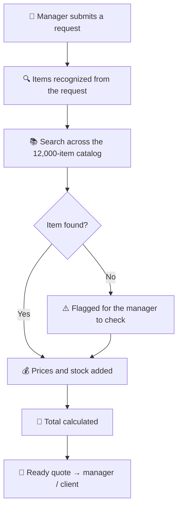

# 🧾 Quotes in 15 Minutes, Not a Full Day

**Request in → ready quote out.**

An n8n workflow that prepares quotes for the manager: it finds the right items in a 12,000-item catalog, pulls in prices and stock, calculates the total and assembles a ready quote in the company template.

Built and running in a real client project.

| | Before | After |
|---|---|---|
| ⏱ Time per quote | ~1 working day | **under 15 minutes** |
| 🔍 Catalog search | Manual, item by item | Automatic, across 12,000 items |
| 💰 Prices & stock | Checked one by one | Pulled in automatically |
| 📄 Quote document | Assembled by hand | Generated from the company template |
| 📨 Client reply | Next day | Same day |

---

## 🔴 The challenge

Every quote was put together by hand:

- The manager searched a **12,000-item catalog** manually
- Prices and stock were checked **one item at a time**
- The quote document was **assembled by hand**
- A single quote took **almost a full working day**
- Clients waited — and some requests went to faster competitors

---

## 🟢 The solution

A workflow that prepares quotes for the manager:

- **Request intake** — the manager enters an item list or simply pastes the client's message
- **Item matching** — the system recognizes items and finds matches across 12,000 catalog entries
- **Prices & stock** — current prices and stock levels pulled in automatically
- **Calculation** — the total is calculated automatically
- **Quote generation** — a ready quote in the company template
- **Exceptions** — if an item isn't found, the system flags it for the manager to check

---

## ⚙️ How it works

**One request — one ready quote.**

---

## 🛠 Tools

| Tool | Purpose |
|------|---------|
| n8n | Main automation engine |
| Google Sheets | Catalog & pricing data |
| API | Prices and stock levels |

---

## 📊 Results

- ✅ Quotes ready in **under 15 minutes** instead of a full day
- ✅ No more manual searching through **12,000 items**
- ✅ Managers handle **more requests** in the same time
- ✅ Clients get a reply **the same day**, not the next

> **Honest about the limits:** custom items and special terms are still approved by the manager. The system takes over the routine — the manager keeps control over the non-standard cases.

---

## 📬 Need something similar?

If your team spends hours putting together quotes, price lists or proposals by hand — this can be automated.

Let's talk → [LinkedIn](https://www.linkedin.com/in/maksim-kosourov-47b1b8417/) or email: maxkosourov1@gmail.com
